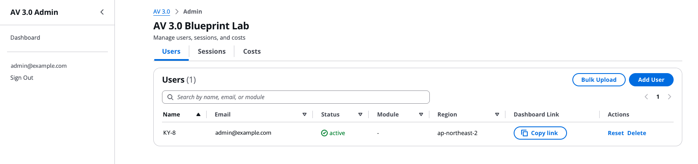
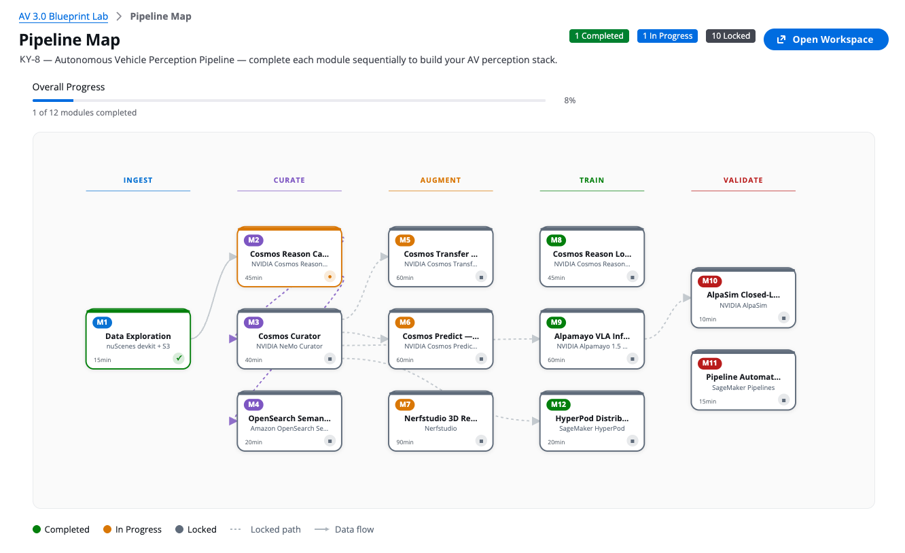

<!-- Language: **English** · [한국어](docs/ko/README.md) · [日本語](docs/ja/README.md) -->

# AV 3.0 Blueprint Lab

**📖 Docs:** **English** · [한국어](docs/ko/README.md) · [日本語](docs/ja/README.md)

A self-service AWS platform for hands-on execution of the [Building an End-to-End Physical AI Data Pipeline for Autonomous Vehicle 3.0 on AWS with NVIDIA](https://aws.amazon.com/blogs/industries/building-an-end-to-end-physical-ai-data-pipeline-for-autonomous-vehicle-3-0-on-aws-with-nvidia/).
Participants work through **13 Jupyter notebook modules
(M0–M12)** covering the full autonomous-vehicle data pipeline — data exploration,
video captioning (Cosmos Reason), data curation (Cosmos Curator), synthetic
augmentation (Cosmos Transfer & Predict), vision-language-action inference
(Alpamayo), closed-loop simulation (AlpaSim), semantic search, distributed
training, 3D reconstruction, and production pipeline automation.

The platform deploys as a **single AWS CDK stack** with admin + participant
dashboards, multi-user SageMaker Studio provisioning, and automated cost controls.
Anyone can deploy it into **their own AWS account**.

> This repository ships **workshop code and docs only**. It orchestrates
> third-party models and datasets (NVIDIA Cosmos/Alpamayo, nuScenes, NuRec) that
> you download yourself under **their own licenses** — some **non-commercial**.
> See [NOTICE](NOTICE).

---

## The 13 modules

| Module | Blog stage | What it does | Recommended instance |
|---|---|---|---|
| **M0** | — | Pipeline overview — maps the end-to-end pipeline to the modules (no compute) | `ml.t3.medium` (CPU) |
| **M1** | 1–2 | Data Exploration — ingest & explore real **nuScenes-mini** sensor data; select scenes | `ml.t3.medium` (CPU) |
| **M2** | 3 | Cosmos Reason Captioning — VLM captions of sampled clips | `ml.g5.12xlarge` (GPU) |
| **M3** | 3 | Cosmos Curator — **NeMo Curator** video curation (split, transcode, motion-filter) | `ml.g5.12xlarge` (GPU) |
| **M4** | 4 | OpenSearch Semantic Search — k-NN retrieval over caption embeddings | `ml.t3.medium` (CPU) |
| **M5** | 5 | Cosmos Transfer — weather/condition augmentation of real clips | GPU (`ml.g5.12xlarge`) |
| **M6** | 5 (ext) | Cosmos Predict — synthetic scenario (video2world) generation | GPU (`ml.g5.12xlarge`) |
| **M7** | 6 | Nerfstudio 3D Reconstruction — NeRF / 3D Gaussian Splatting (optional/demo) | `ml.g5.xlarge` (GPU) |
| **M8** | 7 | Cosmos Reason LoRA SFT — parameter-efficient fine-tune on nuScenes **human** labels | GPU (`ml.g5.12xlarge`, native-res measured on 4× 24 GB) |
| **M9** | 7 | Alpamayo VLA — **Alpamayo-1.5-10B** vision-language-action inference + trajectory | GPU (`ml.g5.12xlarge`) |
| **M10** | 8 | AlpaSim Closed-Loop Eval — visualize genuine closed-loop policy evaluation | `ml.t3.medium` (CPU) + GPU EC2 |
| **M11** | — (ext) | Pipeline Automation — a real SageMaker Pipeline (Caption→Curate→Augment) | `ml.t3.medium` (CPU) + processing job |
| **M12** | — (ext) | HyperPod Distributed Training — a real 2-node `torch.distributed` DDP job | `ml.t3.medium` (CPU) + job nodes |

**The numbering follows the blog's 8-stage order**, so running M0 → M1 → M2 → … in
sequence walks the pipeline as the blog describes it. M11 and M12 are extensions
with no blog stage of their own, so they are numbered last — but on the pipeline map
each sits in the phase it belongs to, which puts M12 under TRAIN and M11 under
VALIDATE.

Recommended path: straight through **M0 → M10**, then the extensions (M11, M12).
If you only want one branch: synthetic data is M5/M6, policy + simulation is
M8/M9/M10, search is M4.
Instances shown are the dashboard defaults; each GPU module also offers
alternatives (the dashboard only offers types the deploy region sells, and refuses one
whose quota is 0).

For how these modules map to the **8-stage pipeline** described in the AWS blog
post above, see [Participant Pre-Learning Guide § 2 "The 8-stage pipeline (and how
the modules map to it)"](docs/en/PRE_LEARNING_GUIDE.md#the-8-stage-pipeline).

---

## Preview before you install

Want to see what the lab produces before deploying anything?

**Executed notebook results.** [`examples/notebooks-with-outputs.tar.gz`](https://github.com/aws-samples/kr-tech-blog-sample-code/raw/main/av3.0-blueprint-lab/examples/notebooks-with-outputs.tar.gz)
contains all 13 module notebooks (M0–M12) **with their output cells** from one
end-to-end run in `ap-northeast-2` on `ml.g5.12xlarge` — 11 plots, 3 playable
embedded H.264 videos (M5, M6, M10), metrics, and logs. Every code cell carries an
execution count and none produced an error output. Download and open them in any
Jupyter viewer to see each module's actual results **without installing or running
anything**. The eight helper scripts are bundled under `scripts/` as they were at run
time. (The AWS account id was replaced with `<aws-account-id>`; nothing else in the
captured outputs was rewritten.)

```bash
curl -L -O https://github.com/aws-samples/kr-tech-blog-sample-code/raw/main/av3.0-blueprint-lab/examples/notebooks-with-outputs.tar.gz
tar xzf notebooks-with-outputs.tar.gz
```

**Verified end-to-end run.** The table below is a measured record, not a claim — every
number came from the deployed account after the run finished.

| | |
|---|---|
| Region | `ap-northeast-2` (Seoul) |
| Instance | `ml.g5.12xlarge` — 4× A10G, 96 GB total |
| Space volume | 200 GB (the domain default) |
| Date | 2026-09-27 |
| Modules | **M0 → M12, all 12 progress markers `completed`**, no module halted |
| Outputs | 72 objects across `m1`–`m12` in the participant workspace (M8 the largest at 154.5 MiB) |

`m10` has no prefix of its own on purpose: M10 is a visualizer over the admin's
`m10-reference/` eval, so it writes nothing per participant.

Four prerequisites were required to get there, and each was a real failure first — treat
them as part of the setup, not as trivia:

1. `hf-cache/` seeded **in this region** (README step 6b). Without it M5/M6/M9 die seconds
   into `torchrun` on a gated-repo refusal.
2. The 200 GB space volume. The old 5 GB default runs out during the Cosmos builds.
3. `USE_TF=0` in M2/M4/M8 (M2 and M8 also set `USE_TORCH=1`), which keeps TensorFlow out of
   the transformers import chain. Grep `USE_TF`, not `USE_TORCH`, when debugging M4 — it sets
   `USE_TF=0` + `USE_FLAX=0` and never sets `USE_TORCH`.
4. Awareness that M7 downgrades `protobuf` for the rest of the app session (M7 now says so).

**Admin dashboard.** The admin adds or removes participants here. Each row's
**Dashboard Link → Copy link** copies that participant's personal dashboard URL to
hand out, and the read-only **Region** column records the region the profile was
provisioned in — a Studio domain is regional, so a mis-provisioned participant would
otherwise look healthy. **Sessions** refreshes every 30 s; **Costs** charts the last
14 days of daily spend.



**Participant dashboard.** Each participant opens their own dashboard to launch
their SageMaker workspace and run the notebooks. Its pipeline map lays the 12 modules
out in five phase columns — **INGEST → CURATE → AUGMENT → TRAIN → VALIDATE** — marks
each one completed, in progress or locked, and draws an arrow wherever one module's
output feeds another. One JupyterLab workspace serves every module, so the
participant points it at the instance the next notebook needs (CPU or GPU), starts
it, opens the workspace, and runs the notebook.



---

## Which docs to read

Full guides live under **`docs/<lang>/`** in **English / 한국어 / 日本語**
([en](docs/en/README.md) · [ko](docs/ko/README.md) · [ja](docs/ja/README.md)):

| You are… | Read (in order) |
|---|---|
| **Admin — setting up the lab** | [PREREQUISITES](docs/en/PREREQUISITES.md) → [ADMIN_GUIDE](docs/en/ADMIN_GUIDE.md) → [DATA_CONTRACT](docs/en/DATA_CONTRACT.md) |
| **Participant** | [PRE_LEARNING_GUIDE](docs/en/PRE_LEARNING_GUIDE.md) → [PARTICIPANT_GUIDE](docs/en/PARTICIPANT_GUIDE.md) |
| **Per-module deep dives** | [COSMOS_M5_M6](docs/en/COSMOS_M5_M6.md) · [ALPAMAYO_M9](docs/en/ALPAMAYO_M9.md) · [ALPASIM_M10](docs/en/ALPASIM_M10.md) · [HYPERPOD_M12](docs/en/HYPERPOD_M12.md) · [PIPELINE_M11](docs/en/PIPELINE_M11.md) |
| **M10 GPU / SSM (advanced)** | [M10_MANUAL_TEST_RUNBOOK](docs/en/M10_MANUAL_TEST_RUNBOOK.md) (admin) · [M10_PARTICIPANT_SSM_RUNBOOK](docs/en/M10_PARTICIPANT_SSM_RUNBOOK.md) (participant) |

---

## Prerequisites

| Requirement | Version | Notes |
|---|---|---|
| AWS Account | — | With SageMaker, S3, DynamoDB, Cognito, CloudFront access |
| AWS CLI | v2.x | Configured (`aws sts get-caller-identity`) |
| Node.js | 18+ | CDK CLI + frontend builds |
| Python | 3.12+ | CDK infrastructure code |
| AWS CDK | 2.x | `npm install -g aws-cdk` |
| jq | — | JSON parsing in deploy scripts |
| Hugging Face token | — | **Admin-only** — pre-caches gated models (M2/M5/M6/M9) and runs the M10 reference eval. **Participants need NO HF token.** See [docs/en/PREREQUISITES.md](docs/en/PREREQUISITES.md). |
| NGC API key | — | **Admin-only, M10 only** — the AlpaSim NuRec renderer image. |

### Service quotas (request early — 24–48 h lead time)

GPU **Studio JupyterLab App** quotas default to low or **0** on fresh accounts —
request increases before the workshop. There are also separate **job** quotas for
M12/M11 that are easy to miss. Full table + CLI commands: **[docs/en/ADMIN_GUIDE.md](docs/en/ADMIN_GUIDE.md)** and **[docs/en/PREREQUISITES.md](docs/en/PREREQUISITES.md)**.

Check what YOUR account has in the region you intend to deploy to — quota is scoped to
`(account × region)`, so a value in one region says nothing about another:

```bash
./scripts/check_quotas.py --region <region> --participants <cohort-size>
```

It cross-references live quota, what the region actually sells for Studio-JupyterLab, and the
instance each module recommends — and names the modules blocked by any shortfall. Measured in the reference
account: both us-west-2 and ap-northeast-2 pass at **5** concurrent participants and
neither passes at 10 — `ml.g5.12xlarge` and `ml.g5.xlarge` are quota 5 in both. Raise
those two to your headcount for a bigger room. `deploy.sh` runs this for you at the end of a deployment.


---

## Quick Start

All commands derive your account and region from the environment — nothing is
hardcoded.

```bash
# 1. Clone
git clone https://github.com/aws-samples/kr-tech-blog-sample-code.git
cd kr-tech-blog-sample-code/av3.0-blueprint-lab

# 2. Required environment variables
export ADMIN_EMAIL="<admin-email>"           # e.g. you@example.com
export REGION="us-west-2"                     # the ONE region to deploy to
export AWS_REGION="$REGION"                   # used by the seeding scripts below
export HF_TOKEN="hf_..."                      # admin Hugging Face read token
# Optional but recommended: restrict admin-dashboard access to your IP/CIDR
export ADMIN_IP_ALLOWLIST="203.0.113.0/24"    # default 0.0.0.0/0 = WAF open

# 2b. Accept gated model/dataset licenses on Hugging Face (before Step 6).
#     Log in to huggingface.co and click "Agree and access repository" on each
#     gated repo — full list in docs/en/PREREQUISITES.md.

# 3. Bootstrap CDK (one-time per account + region)
cd infra && python3 -m venv .venv && source .venv/bin/activate && pip install -r requirements.txt
npx cdk bootstrap "aws://$(aws sts get-caller-identity --query Account --output text)/$REGION"
cd ..

# 3b. Generate this region's instance rate table (REQUIRED).
#     The Lambdas raise at import without it rather than quote another region's
#     prices, so a missing table shows up as 500s on the instance endpoints.
./scripts/refresh_instance_rates.py --region "$REGION" --merge

# 4. Deploy infrastructure + dashboards (~25 min). Region is EXPLICIT — there is no
#    literal default anywhere in the deploy path.
./scripts/deploy.sh --region "$REGION"

# 5. Create the first Cognito admin user
#    (deploy.sh prints the exact command with your pool id; username MUST be an email)
aws cognito-idp admin-create-user \
    --user-pool-id <cognito-pool-id> \
    --username "$ADMIN_EMAIL" \
    --user-attributes Name=email,Value="$ADMIN_EMAIL" Name=email_verified,Value=true \
    --temporary-password 'TempPass1!' \
    --region "$AWS_REGION"

# 6. Pre-cache NVIDIA models to S3 (background, 30–60 min)
AWS_REGION="$REGION" ./scripts/cache_models.sh
#    This seeds model-cache/ ONLY (M2, M8). It does NOT seed the HuggingFace offline
#    cache that M5/M6/M9 read. Step 6b is not optional — see the warning below.

# 6b. Seed the HuggingFace offline cache — REQUIRED for M5, M6, M9, M10.
#     Two paths; which applies depends on whether you already have a working region.
#     Both are runnable commands — neither is "see another document":
#
#  IF you already run the lab in another region (the usual case for region #2+):
ACCOUNT=$(aws sts get-caller-identity --query Account --output text)
SEEDED=us-west-2                      # a region where the lab already works
aws s3 sync "s3://av30lab-shared-data-$ACCOUNT-$SEEDED/hf-cache/" \
            "s3://av30lab-shared-data-$ACCOUNT-$REGION/hf-cache/" \
            --source-region "$SEEDED" --region "$REGION"       # ~115 GiB, 25-55 min
aws s3 sync "s3://av30lab-shared-data-$ACCOUNT-$SEEDED/m10-reference/" \
            "s3://av30lab-shared-data-$ACCOUNT-$REGION/m10-reference/" \
            --source-region "$SEEDED" --region "$REGION"
#     Sync hf-cache/ — NOT hf-cache/hub/ — or the tree nests one level too deep and
#     M9's demo clip lands in the wrong place.
#
#  IF this is your FIRST region (nothing to copy from) — builds the tree from the
#  pinned manifest. No GPU, no notebook run; needs ~65 GiB scratch and 30-60 min.
#  This is what Step 2b's license acceptance and the HF_TOKEN above are for:
AWS_REGION="$REGION" HF_TOKEN="$HF_TOKEN" ./scripts/cache_hf_tree.sh
#     Preview what it would fetch, without a token:  ./scripts/cache_hf_tree.sh --dry-run
#     M9 additionally needs its demo clip — docs/en/ADMIN_GUIDE.md §6.3.
#
# 6c. VERIFY — do not infer. Must exit 0 BEFORE you provision any participant.
./scripts/check_seeding.sh --region "$REGION"        # add --source-region "$SEEDED" to compare checksums

# 7. Stage the nuScenes-mini dataset to S3
#    Required by M1, M2, M3, M5, M6, M7, M8, M9. M8 hard-fails without the annotation
#    tables (its cell 4 raises SystemExit per missing table), so this is not optional
#    for the Training module.
AWS_REGION="$REGION" ./scripts/stage_nuscenes.sh
#    Pulls from the public AWS Open Data mirror (no login; nuScenes terms apply).

# 8. Upload notebook templates + helper scripts to the shared bucket
ACCOUNT=$(aws sts get-caller-identity --query Account --output text)
# --exclude matters: without it a local scripts/__pycache__/*.pyc gets staged and then
# syncs into EVERY participant workspace (measured: 4 stray .pyc in one region).
aws s3 sync notebooks/ "s3://av30lab-shared-data-$ACCOUNT-$REGION/notebook-templates/" \
    --region "$REGION" --exclude "*__pycache__*" --exclude "*.pyc"
aws s3 sync scripts/   "s3://av30lab-shared-data-$ACCOUNT-$REGION/notebook-templates/scripts/" \
    --region "$REGION" --exclude "*__pycache__*" --exclude "*.pyc"
```

> **Steps 6b and 6c are the two that get skipped, and skipping them ships a broken
> region.** Every other step here is a runnable command that succeeds; the HuggingFace
> offline cache had no producer script at all, so it used to appear only as a prose aside
> pointing at another document (`scripts/cache_hf_tree.sh` now builds it). Measured on
> 2026-09-26: an
> ap-northeast-2 deployment that ran steps 1-8 and skipped 6b came up with **M5, M6, M9
> and M10 unable to run**. `deploy.sh` reported success, all 15 of its guards were green,
> and the Day-1 smoke test passed — because it exercises M1 and M2, the only two modules
> `cache_models.sh` covers. The first thing to notice was a participant four modules in,
> holding a $8.72/hr GPU. `check_seeding.sh` (6c) is what makes that state visible in
> seconds instead.

Then open the **Admin Dashboard URL** printed by `deploy.sh`, log in with the
email + temporary password from Step 5, provision a test user, and open the
**Participant Dashboard Link** to verify the pipeline map. The full day-by-day
runbook — smoke test, bulk provisioning, monitoring, teardown — is in
**[docs/en/ADMIN_GUIDE.md](docs/en/ADMIN_GUIDE.md)**.

---

## Architecture

```
        CloudFront (2x)  ─────────  Admin Dashboard  |  User Dashboard
              │                              │
        S3 static (admin)               S3 static (user)
              │
        API Gateway + Lambda  ── create_user, delete_user, bulk_provision,
              │                    list_sessions, terminate_session,
              │                    change_instance, get_costs, update_progress, …
   ┌──────────┼───────────────────────────────┐
 Cognito   DynamoDB                    SageMaker Studio Domain
 (auth)    (sessions,                  └─ per-user profile + JupyterLab space
            progress)                        │
                                       S3 shared-data bucket
                                        (model-cache / datasets / hf-cache /
                                         notebook-templates / m10-reference)
```

- **Network:** NAT-free VPC with isolated private subnets and a free S3 *gateway* endpoint.
  There is **no NAT Gateway** — the Studio domain runs `PublicInternetOnly`, so notebook
  traffic egresses via a SageMaker-managed VPC and this VPC carries only EFS/home-dir
  traffic. The 6 paid *interface* endpoints are off by default (nothing in the VPC uses
  them: the Lambdas are not VPC-attached); enable with `-c vpc_interface_endpoints=true`
  if you switch the domain to `VpcOnly`.
- **Storage:** KMS-encrypted S3 (shared data + per-user workspaces); pre-cached models.
- **Compute:** SageMaker Studio Domain with a lifecycle config for auto-setup.
- **Auth:** Cognito user pool with an optional **WAF IP allowlist** for the admin plane.
- **API:** Lambda-backed REST API for user management, sessions, and progress.
- **Monitoring:** CloudWatch alarms, SNS notifications, a daily budget alert.
- **Frontends:** React SPAs on CloudFront (admin dashboard + user pipeline map).

---

## Project structure

```
av3.0-blueprint-lab/
├── infra/                  # AWS CDK app (Python): stack, constructs, Lambdas
│   ├── app.py  cdk.json  requirements.txt
│   ├── stacks/av30_stack.py
│   ├── av30_constructs/    # network, storage, database, sagemaker, auth, api, dashboards, monitoring
│   └── lambda/             # create_user, delete_user, bulk_provision, change_instance, get_costs, update_progress, …
├── notebooks/              # 13 workshop notebooks M0–M12
├── web/
│   ├── admin/              # Admin dashboard (React + Vite)
│   └── user/               # Participant pipeline map (React + Vite)
├── scripts/                # deploy.sh, teardown.sh, cache_models.sh, stage_nuscenes.sh,
│                           # setup_*.sh, alpasim_ec2_setup.sh, grab_gpu_instance.py, …
├── docs/{en,ko,ja}/        # Full trilingual documentation set
├── LICENSE                 # MIT-0 (workshop code)
├── NOTICE                  # third-party model/dataset licenses (incl. non-commercial)
└── README.md               # this file
```

---

## Cost & cleanup

| Scenario | Cost | Notes |
|---|---|---|
| Idle (infra only) | **~$1/mo per region** | KMS key. The S3 gateway endpoint is free and there is no NAT Gateway; DynamoDB (on-demand), CloudFront and Cognito are \~$0 at idle. Add **\~$87.60/mo per region** only if you enable the 6 VPC interface endpoints (12 ENIs x $0.01/AZ-hour). S3 storage for the model cache is extra (~$2/mo per region). |
| GPU modules | per-hour | `ml.g5.xlarge` ~$1.41/hr (M7), `ml.g5.12xlarge` ~$7.09/hr (M2/M3), `ml.g5.12xlarge` is also the M5/M6/M8/M9 default. Full-resolution output needs ≥38 GB/GPU: `ml.g7e.2xlarge` ~$4.20/hr is the cheapest route (1× 96 GB — cheaper than the default, but quota defaults to 0 and it is unverified here), `ml.p4d.24xlarge` ~$25.25/hr otherwise |
| M10 AlpaSim on EC2 | ~$30 one-time (admin) | reference eval on `g6e.12xlarge`; optional participant self-run ~$10.5/hr/host |
| Full week (mixed) | ~$400–600+ | dominated by the p4d modules and user count |

**Cost controls:** daily budget alarm (SNS → `<admin-email>`), admin
force-terminate from the Sessions tab, and idle auto-stop of
JupyterLab apps (90 min default; `-c idle_timeout_minutes=<60..180>`). **Teardown:** `scripts/teardown.sh` (dry-run by default; `--yes`,
`--user <id>`, `--destroy`) removes per-user apps/spaces/profiles, sweeps orphaned
OpenSearch Serverless collections, and terminates tagged GPU EC2 hosts. After the
event, **revoke the admin HF token and rotate the NGC key**. Details in
[docs/en/ADMIN_GUIDE.md](docs/en/ADMIN_GUIDE.md).

---

## Region selection

Region is chosen per deployment with `./scripts/deploy.sh --region <region>` — one region
at a time. See [docs/en/ADDING_A_REGION.md](docs/en/ADDING_A_REGION.md) to add another later.

Two DIFFERENT facts decide whether a GPU type is usable, and the old table here conflated
them — it marked `ml.p5.48xlarge` available in us-east-1 when this account has quota 0 there,
and implied only three regions were possible when the p5 quota actually exists in ten:

1. **Does the region sell it for Studio-JupyterLab?** Generated, measured per region
   (`$/hr`, `—` = not sold there):

   | Region | g5.12xlarge | g5.24xlarge | g6.24xlarge | g7e.2xlarge | p4d.24xlarge | p5.48xlarge |
   |---|---|---|---|---|---|---|
   | us-west-2 | $7.09 | $10.18 | $8.34 | $4.20 | $25.25 | $63.30 |
   | us-east-1 | $7.09 | $10.18 | $8.34 | $4.20 | $25.25 | $63.30 |
   | ap-northeast-1 | $10.28 | $14.76 | $12.10 | — | $34.61 | $79.12 |
   | ap-northeast-2 | $8.72 | $12.52 | $10.26 | — | $34.97 | — |
   | eu-west-1 | $7.92 | $11.36 | — | — | $27.27 | — |

   Regenerate, or add a region, with:
   `./scripts/refresh_instance_rates.py --region <region> --merge`
   A region with no generated table makes the Lambdas raise at import rather than quote
   another region's prices.

2. **Does YOUR account have quota, in THAT region, for your cohort size?** Quota is scoped to
   `(account × region)` — an increase approved in one region does nothing for another — and
   the default for big GPU types is often 0. Check before you commit to a region:

   ```bash
   ./scripts/check_quotas.py --region <region> --participants 10
   ```

   It cross-references the rate table, live quotas, and the modules' recommended instances.
   Measured for this account: both us-west-2 and ap-northeast-2 run every recommended
   type for **5** concurrent participants, the cap in both being quota 5 on
   `ml.g5.12xlarge`/`ml.g5.xlarge`. ap-northeast-2 has quota **0** for the whole `ml.g6`
   family and does not sell `ml.g7e.*`/`ml.p5.*` at all, which is why nothing the
   dashboard recommends is a `g6` type.

S3 model-cache paths are region-local — stage data into the region you deploy to
(`AWS_REGION=<region> ./scripts/cache_models.sh`; the script refuses to guess).

---

## License

The **workshop code** in this repository (CDK infra, Lambdas, notebooks,
dashboards, scripts) is licensed under **MIT-0** — see [LICENSE](LICENSE).

The **models and datasets** the notebooks download are **not** covered by that
license and are **not redistributed** here. Each keeps its own terms — notably
**Alpamayo-1.5-10B (M9/M10) is non-commercial (research/evaluation only)** and
**nuScenes** is non-commercial. Review and comply with every applicable license;
see [NOTICE](NOTICE) for the full list.
